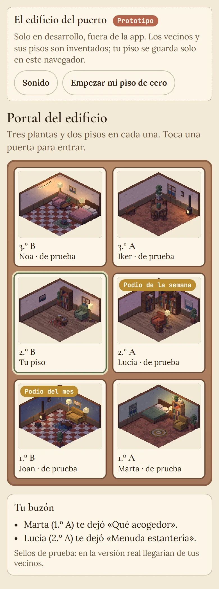
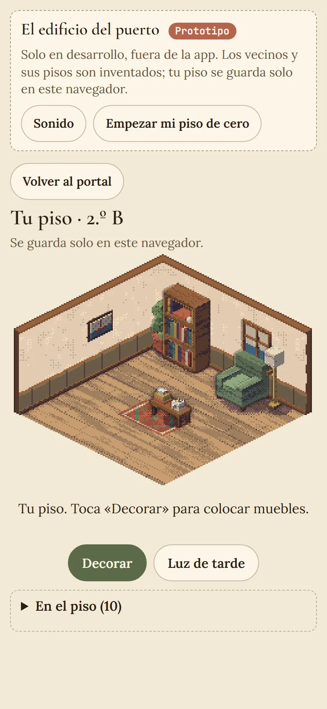
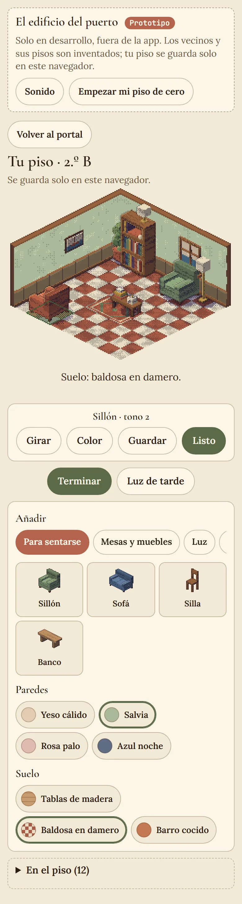
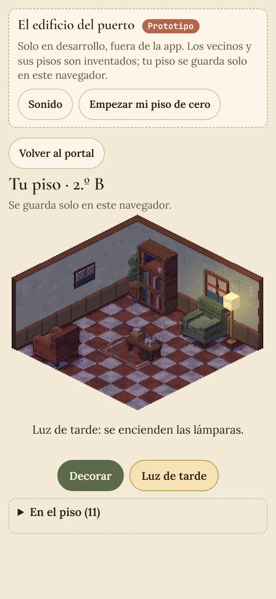
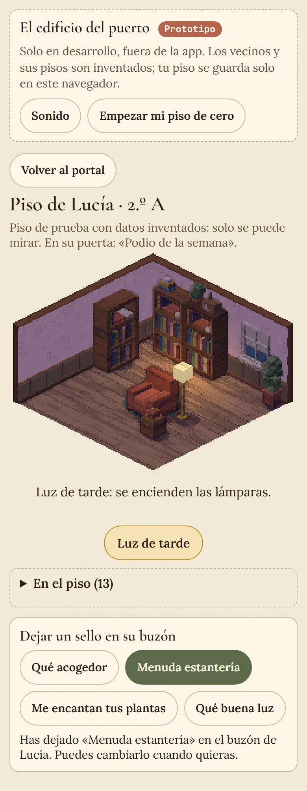
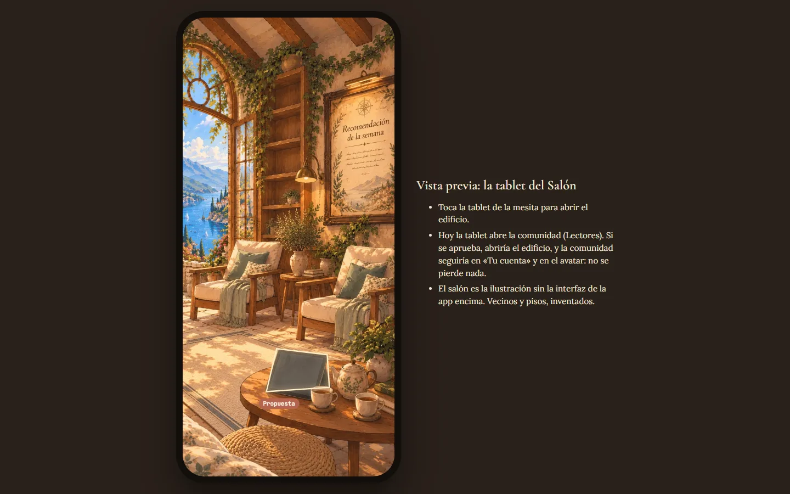
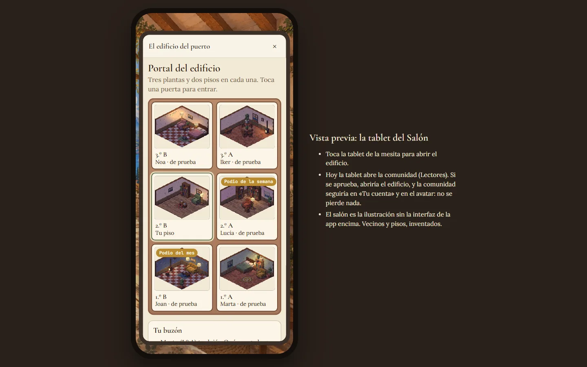
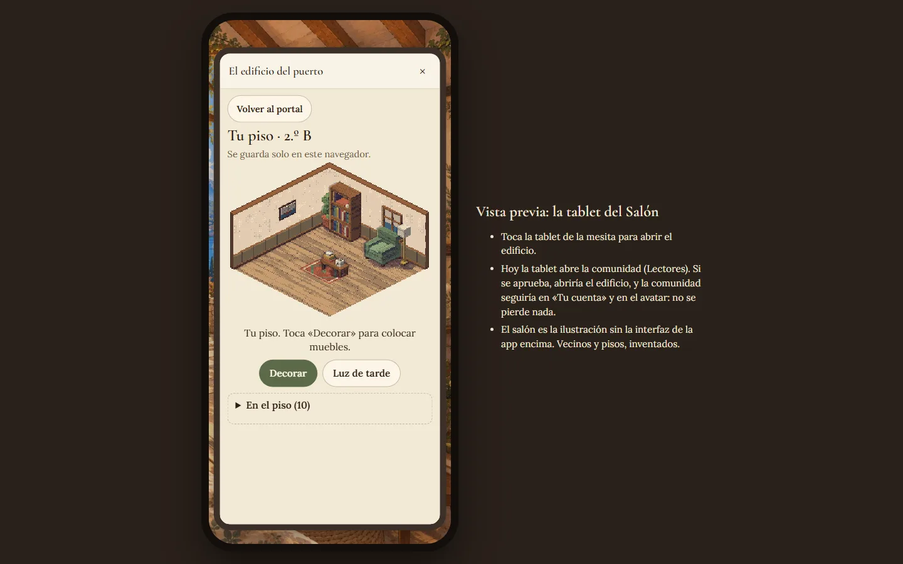

# «El edificio del puerto»: prototipo de pisos cozy con vecinos

Prototipo **solo de desarrollo**: no está en la app, ni en el build, ni en Supabase. Idea de Francisco (1-11-2026), a
partir de un devblog de un juego de pixel art donde se decora una casa sobre una cuadrícula. De ese vídeo se toma el
género (habitación cozy, muebles que se colocan, vecinos que se visitan), **no** su arte ni su estilo: todo lo que se ve
está dibujado con el motor de píxeles de «La librería del puerto» (adaptado de Pixel Plays, MIT).

## Cómo se prueba

```bash
npm run dev -- --port 5190 --strictPort
```

- Edificio: http://localhost:5190/dev/edificio-puerto.html
- Cómo se vería en la app (la tablet del Salón Social): http://localhost:5190/dev/edificio-puerto-app.html
- Pruebas: `npx vitest run src/features/minigames` y `npx playwright test e2e/edificio-puerto.spec.js`

## Lo que se acordó con Francisco (y aplica el prototipo)

1. **Es tu piso, no tu rincón.** El rincón ilustrado, con su visita y su vídeo, se queda como está. El piso es otra cosa:
   un piso en un edificio del puerto.
2. **Edificio pequeño:** tres plantas con dos pisos cada una (seis pisos, puertas 1.º A … 3.º B).
3. **Visitas en diferido:** entras en el piso de alguien y lo ves como lo dejó. Coincidir en directo queda para más
   adelante (Supabase Realtime).
4. **Catálogo gratis:** no se tocan las reglas de recompensas, piezas, cajas ni pity.
5. **Sin texto libre:** solo muebles del catálogo y **sellos** de frase cerrada en el buzón del vecino («Qué acogedor»,
   «Menuda estantería», «Me encantan tus plantas», «Qué buena luz»). No hay que moderar nada.
6. **Arte provisional:** muebles hechos con cajas, como la estantería del puzle. Ver «Recursos».
7. **Reestructurar la comunidad necesita su aprobación:** hoy la tablet abre Lectores (decisión de la 1.62). La vista
   previa enseña cómo sería que abriera el edificio; la app no se ha tocado.

## Qué hace el prototipo

**Portal.** Los seis buzones con una miniatura de cada piso de tarde. Tu puerta va resaltada. Dos vecinos llevan en la
puerta la distinción del ranking de la librería («Podio de la semana», «Podio del mes»). Debajo, tu buzón con dos sellos
de prueba.

**Tu piso** (2.º B, cuadrícula de 9 × 9, paredes al fondo y a la izquierda):

- «Decorar» abre el catálogo: 24 cosas en siete grupos (asientos, mesas y muebles, luz, plantas, detalles, pared,
  alfombras), con miniaturas dibujadas por el propio motor. Cada una cae en el primer hueco libre.
- **Capas:**
  - Alfombras en el suelo, por debajo de todo.
  - Muebles: no se pisan entre sí, pero sí pueden ir sobre una alfombra.
  - Cosas pequeñas: lámpara de mesa, planta, libros, radio y tetera solo van encima de un mueble con superficie (mesa,
    mesilla, banco o estantería).
  - Pared: ventana al mar, cuadro, reloj y guirnalda, en la pared del fondo o en la de la izquierda.
- **Mover:** se arrastra con el dedo o se toca un hueco. Si al soltar no cabe, vuelve a su sitio y se explica por qué
  («Choca con: sofá.», «Va encima de una mesa…»). Lo que hay encima de un mueble se mueve con él. Un mueble con cosas
  encima no se gira ni se guarda («Primero quita lo que tiene encima.»).
- **Girar** un cuarto de vuelta. Si girado no cabe, busca el hueco más cercano.
- **Color:** de tres a cinco tonos por mueble. **Guardar** lo quita del piso.
- Paredes en cuatro colores y tres suelos: tablas, damero y barro cocido.
- **Luz de tarde:** la habitación se oscurece y las lámparas, la estufa y la guirnalda iluminan a su alrededor.
- **La estantería abre la librería:** sin decorar, al tocarla aparece «Ordenar la estantería», que lleva al nivel de la
  semana de «La librería del puerto».
- Se guarda en este navegador (`bookshelf:dev:edificio-puerto:piso`). «Empezar mi piso de cero» vuelve al piso inicial.

**Visitar.** Los cinco pisos de prueba se pueden mirar, pero no tocar: arrastrar no mueve nada. Al tocar un mueble se dice
qué es. Se puede encender la luz de tarde y dejar un sello. «Volver al portal» y el botón atrás del navegador vuelven al
portal.

**Accesibilidad:**

- Todos los botones miden 44 px o más.
- Estado con `aria-live`.
- La lista «En el piso» elige cualquier cosa sin tocar el dibujo.
- Teclado en el lienzo: flechas para mover, R gira, C cambia el color, Supr guarda y Escape suelta.
- Mirando, la página se desplaza por encima del dibujo; decorando, el lienzo se queda los gestos.
- Sin sonido hasta que se activa «Sonido».
- No hay animaciones que dependan del movimiento.

## Capturas

| | |
| --- | --- |
|  |  |
|  |  |
|  |  |
|  |  |

## Pruebas (1-11-2026)

- **Vitest** del minijuego: 42/42, de las que 12 son de las reglas del piso: capas, límites, giro, encima, pared,
  catálogo, máximo de 40 cosas, `validateRoom` y los pisos de prueba.
- **e2e** `edificio-puerto.spec.js`, en Chromium 360/390/430/1440, WebKit 390 y movimiento reducido:
  - Portal.
  - Decorar con arrastre real.
  - Teclado.
  - Visita y sello.
  - La estantería abre la librería.
  - La vista previa de la tablet.
- Junto con la librería: 43 pasan y 0 fallan.
- Es emulación de Playwright: **no** está probado en un iPhone real ni en Safari.

## Versión real (1.63, SPEC §63): hecha, sin commit, migración aplicada

Francisco aprobó el plan («Sí, prepárala») y eligió:

- **Entrada:** la tablet del Salón pregunta entre «Comunidad» (lo de antes) y «El edificio del puerto»; no se quita nada.
- **Reparto al azar, tal cual se propuso:** solo perfiles con la comunidad activada, primero los edificios con hueco,
  puerta libre al azar, y lo decide el servidor.

Lo hecho:

- **Migración** `supabase/migrations/20261101120000_edificio_puerto.sql` (**aplicada en producción el 1-11-2026**:
  la pegó Claude en el SQL Editor y Francisco pulsó «Run»):
  - `piso_catalogo` + `piso_valido` (misma validación que `validateRoom`).
  - `edificios` y `edificio_vecinos` sin acceso directo; `asignar_edificio()` hace el reparto.
  - `pisos` y `piso_sellos` con RLS (solo vecinos del mismo edificio, comunidad activada, sin bloqueos) y límite de
    escrituras.
  - `edificio_portal()`: el portal en una consulta.
- **App:** `src/features/edificio/` (`service.js`, `EdificioPanel.jsx`), tarjeta «La tablet» en `SocialSeats.jsx`,
  panel `edificio` en `App.jsx` y `navigation.js`. Hasta que la migración esté aplicada, la tablet abre la comunidad
  como siempre.
- **Pruebas:** `__tests__/edificio.rls.test.js` (Postgres con la migración, PGlite) y
  `e2e-community/v163-edificio.spec.js` (Supabase simulado).

**Decisiones pendientes:**

- Qué pasa con la puerta de quien deja la app (¿se libera tras un tiempo?). Hoy se queda.

**Recursos (no se han improvisado):**

- Si el estilo de cajas no basta, hacen falta ilustraciones de los muebles en pixel art isométrico, con el mismo ángulo
  y cuatro orientaciones.
- Icono del edificio para la tablet (hoy, el icono `Building2` de lucide).
- No hay personajes que caminen por el piso, como en el vídeo. Si se quieren, hacen falta sprites propios.

**Más adelante:**

- Ver en directo quién está en el edificio (Realtime presence).
- Notificación de sello recibido.
- Que muebles concretos se ganen leyendo, si Francisco lo decide aparte y sin tocar las cajas ni el pity.
